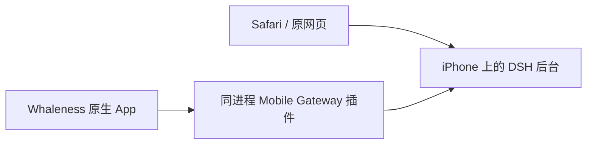

# iPhone 原生 App 接入

本项目复用 [Whaleness](https://github.com/Clarklevis1995/dsh-mobile) 的 SwiftUI/UIKit 界面和 KMP 客户端状态处理。DSH 仍由手机上的 `ai.deepseek.dsh` launchd 服务独立运行，App 访问 `ws://127.0.0.1:3080/ws/mobile`；关闭 App 不会关闭 Harness，原网页入口也继续使用同一后台。



## 版本与职责

| 部分 | 当前版本或目标 | 负责内容 |
| --- | --- | --- |
| Mac / iPhone DSH | `0.2.1-rc.2` | 会话、模型认证、工具、权限、执行和持久化 |
| Provider | `0.2.10` / pi-ai `1.4.0` / zod `4.4.3` | Codex、xAI、Google 路由及偏好；核心 pi-ai `1.3.0` 分开维护 |
| Cline Pass | `0.2.13` | 原有账号、上游通道与模型路由 |
| iPhone Gateway | `0.11.1+iphone.1` | 设备配对与 `dsh-mobile-v1` 传输，复用 Host Remote API |
| Whaleness 本地版 | `1.7.11 / build 34` | 原生聊天、轨迹、模型/权限选择、附件与交互；最低 iOS `16.1` |
| Root 系统集成 | 本项目通知与 Activity 组件 | 本机系统通知、Live Activity 和点击导航 |

源码固定在 `9bf3955c8add4ebffaed5699d59e75ddc86733ad`，许可保留于 `ios/native/LICENSE.whaleness`。本地补丁、版本和能力由 `ios/native/source-patch.json` 锁定。`ios/native/app-release.json` 是上游未修改的 build 32 输入；本地 build 34 必须使用构建器生成的独立 manifest，不能沿用上游 IPA 的 SHA。最终 IPA、源码补丁 hash 和实机结果见[更新记录](./updating.md)。

安装、真实 Keychain 配对、冷启动和旧历史/snapshot 已验证；build 34 升级保留同一容器与配对。用户实机确认回车发送和活动窗跳转正常。中文输入法与硬件键盘保留独立验收项；新增 UIKit/XCTest 源码语法解析通过，未运行 Simulator XCTest，不把源码解析或编译当作所有输入场景的证明。

## 保留现有后台

Gateway 插件挂载在 DSH 已有的 loopback listener，原 HTTP/Web API 与 `/ws/mobile` 共用 `:3080`。手机的 Wi-Fi IP 只用于 SSH 管理，原生 App 本机连接不依赖它。`lanEnabled:false` 避免打开第二个 LAN listener，也不会占用手机上已有的 3081 服务。

网关保留设备鉴权、loopback 管理接口和稳定 `gatewayId`；它不能 fork 新 DSH 来重启/停止 Web，也不支持桌面 Tunnel。服务生命周期继续由 launchd 管理。实机 Node 的平台值为 `ios`，平台判断不能把它当成 macOS 的 `darwin`。

手机上的 `/var/root/.dsh` 仍保存原会话、工作区、Provider 凭据与偏好。App 容器只保存自己的客户端状态、缓存和非敏感主机配置，长期设备凭据由真实 Keychain 管理；不会把 DSH 数据迁进 App。旧 WKWebView 实验壳默认不随核心 deb 安装，`DSH_INCLUDE_LEGACY_WEB_CLIENT=1` 仅用于重现实验，不作为当前入口。

## 构建和部署

先按[双端更新流程](./upgrade-workflow.md)完成 core、Provider、Cline 与网关的候选构建、空闲检查和停机备份。Node、pnpm 及其他原生组件只在本次变化确实需要时升级。

```bash
./scripts/package-dsh.sh
./scripts/package-dsh-codex.sh
./scripts/package-dsh-cline-pass.sh
./scripts/package-mobile-gateway.sh
./scripts/verify.sh
```

`mobile-gateway/package-lock.json` 固定纯 JavaScript 生产闭包；`cline-pass/package-lock.json` 固定官方包，不先更改 Mac live profile。手机使用已生成的本地 tarball 和 `--offline` 安装，Host peers 由当前 DSH 提供。

`scripts/install-native-profile.mjs <profile-dir>` 先报告本机配置计划，`--apply` 才合并 Gateway 与按需搜索配置，并保存原 `cordis.patch.yml` 私有备份。`--runtime` 必须指向该运行环境的 DSH 包目录：Mac 候选通常为 `build/dsh-runtime`，手机安装目录为 `/var/jb/usr/local/lib/dsh`。该脚本处理 **Host profile**，不写 App 主机资料或 Keychain。

默认 `deploy.sh` 完成 Gateway 与 Host profile 接入后保留已安装原生 App。只有显式提供匹配的 `NATIVE_APP_IPA` 和 `NATIVE_APP_MANIFEST` 才请求 App 更新；不因常规后端升级回装 stock build 32。

原生 App 构建需要完整的固定源码、Xcode/Metal 工具链、JDK 17、Gradle 和 Android SDK；shared 的配置阶段也使用 Android SDK。示例：

```bash
NATIVE_APP_SOURCE=/path/to/reviewed-whaleness \
NATIVE_JAVA_HOME=/path/to/jdk17 \
NATIVE_ANDROID_SDK=/path/to/android-sdk \
./scripts/build-native-app.sh
```

构建器校验源码 commit 与补丁预像，先构建 arm64 Release KMP framework，再在私有工程副本归档 App。只在明确本次 framework 已构建并保持输入一致时，才可使用 `NATIVE_SKIP_KMP_BUILD=1` 复用它。

安装本地适配版必须同时指定 IPA 和对应 manifest：

```bash
NATIVE_APP_IPA="$PWD/build/native-app/Whaleness-iphone-1.7.11-build34.ipa" \
NATIVE_APP_MANIFEST="$PWD/build/native-app/native-app-manifest.json" \
DEVICE_HOST='<iPhone IP>' ./scripts/install-native-app.sh
```

安装器校验实际归档 SHA、主 App/Widget 身份与 Mach-O 最低系统版本，再使用设备已有的 TrollStoreLite 安装。保留相同 bundle ID、正常容器和 Keychain；已安装准确版本时跳过，拒绝降级。它不使用旧 WK 壳的 platform/no-sandbox entitlement，不删除用户数据，也不启动或重启 DSH。

## 真实配对与导航

首次配对通过网关实际产生的短期一次性能力完成。经用户授权，`scripts/open-native-app.py --pairing-payload <private-file>` 用 UI 深链交给 App；适配版只接受严格本机端点、版本 2 和有效时限内的 payload，再调用原生握手流程。成功后由 App 自己写入真实 Keychain。脚本不伪造 token、不注入凭据，也不能把 UIopen 已投递当作配对成功。

配对文件只保存实际 `qrPayload`，权限为 `0600`，不能提交仓库或打印到共享日志；完成后按运行流程清理。普通再次打开无需重新配对：

```bash
python3 /var/root/dsh-native-client/scripts/open-native-app.py
```

通知导航使用原生 App 的真实非敏感 profile 映射。服务器 `gatewayId` 和 App `profile.id` 是不同身份，本地 UUID 大小写也必须保留。映射导出只读取已配对主机资料，不读取 Keychain：

```bash
python3 /var/root/dsh-native-client/scripts/open-native-app.py --refresh-mapping
python3 /var/root/dsh-native-client/scripts/open-native-app.py --session SESSION_ID
```

映射位于 `/var/root/.dsh/native-client/gateway-map.json`。Root 通知/Activity 桥校验当前本机网关与激活 profile 后，点击导航到原生根会话；子会话事件归到根会话入口。没有有效原生映射时保留网页回退，不猜测或伪造 App profile。

## 通知、后台和 respring

本机 DSH 一直由 root 后台负责执行和系统集成。Whaleness 对严格 loopback 主机跳过重复的定位/静音音频保活、系统通知和 Live Activity；其有限后台额度、断线恢复以及其他远端主机的行为保留。App 的 UI/socket 状态不成为后台任务是否继续的条件。

仅修改 JS、网页、Gateway 或 App 时，无需 respring。只有通知桥/SpringBoard 注入代码确实改变时，在全部核心与原生组件安装完成后统一进行一次；不在每个阶段重复 respring，也不把它当作修复配对或网络的通用步骤。本次系统桥更新已完成统一的一次 respring，后续仅更新 App 的回车发送实现不再重复执行。

## 验收边界

`scripts/check-native-gateway.mjs` 在转发到本机的认证 Host 通道上创建自己的测试配对，验证真实握手、token 重连、工作区/模型目录、原会话历史与原子 snapshot；结束撤销测试设备并核对原 App 配对仍保留。它不发送 prompt、不改变默认模型，也不向 App Keychain 写入测试凭据。

先在独立终端保持 SSH 转发：

```bash
ssh -N -L 13081:127.0.0.1:3080 root@'<iPhone IP>'
```

再通过 Mac 的该 loopback 端口执行：

```bash
DEVICE_HOST='<iPhone IP>' DEVICE_PORT=22 LOCAL_PORT=13081 \
  node scripts/check-native-gateway.mjs iphone --save .cache/upgrades/iphone-native-api.json
```

API 验证不替代真实 App 验收，需要分别记录：

- 正常安装、真实配对、冷启动及原会话历史，不清空数据重来。
- 回复流、工具结果、图片和普通文件上传，及审批/问答的用户操作。
- 回车发送、Shift+Enter 换行、空输入/发送中行为；中文 marked text 和候选确认不能误发，软件与外接键盘分别核对。
- 横竖屏、安全区、键盘遮挡、上翻阅读位置，以及前后台/锁屏后的恢复。
- 本机通知与 Activity 不重复，点击能打开准确的原生根会话，网页入口仍可用。

Provider 完整目录、设置持久化和真实模型/Bash 仍按双端门禁检查。本次旧 xAI OAuth 的 `invalid_grant` 已由用户官方重新授权解决，严格目录检查重新通过。它与 grok2api 的 `xai` API Key 路由分开；后续再遇到此类授权失败仍须保留凭据并重新授权，不能隐藏失败或删凭据来宣布整体完成。
