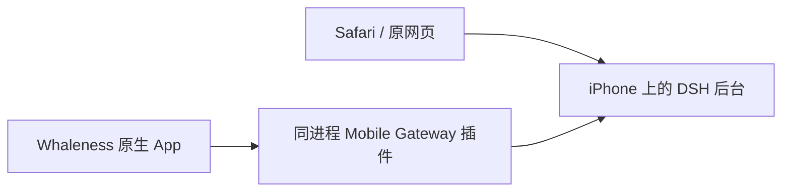
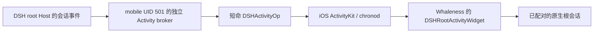

# iPhone 原生 App 接入

本项目复用 [Whaleness](https://github.com/Clarklevis1995/dsh-mobile) 的 SwiftUI/UIKit 界面和 KMP 客户端状态处理。DSH 仍由手机上的 `ai.deepseek.dsh` launchd 服务独立运行，App 访问 `ws://127.0.0.1:3080/ws/mobile`；关闭 App 不会关闭 Harness，原网页入口也继续使用同一后台。



## 版本与职责

| 部分 | 当前版本或目标 | 负责内容 |
| --- | --- | --- |
| Mac / iPhone DSH | `0.2.1-rc.2` | 会话、模型认证、工具、权限、执行和持久化 |
| Provider | `0.2.11` / pi-ai `1.4.0` / zod `4.4.3` | Codex、xAI、Google 路由及偏好；核心 pi-ai `1.3.0` 分开维护 |
| Cline Pass | `0.2.13` | 原有账号、上游通道与模型路由 |
| iPhone Gateway | `0.11.1+iphone.2` | 设备配对与 `dsh-mobile-v1` 传输，复用 Host Remote API |
| Whaleness 本地版 | `1.7.11 / build 39` | 原生聊天与本机活动栏 Widget；最低 iOS `16.1` |
| Root 系统集成 | Debian `0.2.1~rc.2-3` | 本机系统通知、Live Activity 状态与生命周期、点击导航 |

源码固定在 `9bf3955c8add4ebffaed5699d59e75ddc86733ad`，许可保留于 `ios/native/LICENSE.whaleness`。本地补丁、版本和能力由 `ios/native/source-patch.json` 锁定。`ios/native/app-release.json` 是上游未修改的 build 32 输入；本地 build 39 必须使用构建器生成的独立 manifest，不能沿用上游 IPA 的 SHA。最终 IPA、源码补丁 hash 和实机结果见[更新记录](./updating.md)。

既有 build 34 的安装、真实 Keychain 配对、冷启动和旧历史/snapshot 已验证，升级保留同一容器与配对；用户实机确认回车发送和活动窗跳转正常。build 37 已独立通过 Widget 承载、锁屏实际显示、后台创建/更新/结束与点击会话验收；用户确认锁屏返回停留后不再出现 `subscription-timeout`。中文输入法与硬件键盘保留独立验收项；UIKit/XCTest 源码语法解析不代替 Simulator XCTest 或输入场景实测。

## 保留现有后台

Gateway 插件挂载在 DSH 已有的 loopback listener，原 HTTP/Web API 与 `/ws/mobile` 共用 `:3080`。手机的 Wi-Fi IP 只用于 SSH 管理，原生 App 本机连接不依赖它。`lanEnabled:false` 避免打开第二个 LAN listener，也不会占用手机上已有的 3081 服务。

网关保留设备鉴权、loopback 管理接口和稳定 `gatewayId`；它不能 fork 新 DSH 来重启/停止 Web，也不支持桌面 Tunnel。服务生命周期继续由 launchd 管理。实机 Node 的平台值为 `ios`，平台判断不能把它当成 macOS 的 `darwin`。

手机上的 `/var/root/.dsh` 仍保存原会话、工作区、Provider 凭据与偏好。App 容器只保存自己的客户端状态、缓存和非敏感主机配置，长期设备凭据由真实 Keychain 管理；不会把 DSH 数据迁进 App。旧 WKWebView 实验壳默认不随核心 deb 安装，`DSH_INCLUDE_LEGACY_WEB_CLIENT=1` 仅用于重现实验，不作为当前入口。

## 构建和部署

先按[双端更新流程](./upgrade-workflow.md)完成 core、Provider、Cline 与网关的候选构建、空闲检查和停机备份。Node、pnpm 及其他原生组件只在本次变化确实需要时升级。

```bash
./scripts/package-dsh.sh
./scripts/package-dsh-codex.sh
./scripts/package-dsh-cline-pass.sh
./scripts/package-mobile-gateway.sh
./scripts/verify.sh
```

`mobile-gateway/package-lock.json` 固定纯 JavaScript 生产闭包；`cline-pass/package-lock.json` 固定官方包，不先更改 Mac live profile。手机使用已生成的本地 tarball 和 `--offline` 安装，Host peers 由当前 DSH 提供。

`scripts/install-native-profile.mjs <profile-dir>` 先报告本机配置计划，`--apply` 才合并 Gateway 与按需搜索配置，并保存原 `cordis.patch.yml` 私有备份。`--runtime` 必须指向该运行环境的 DSH 包目录：Mac 候选通常为 `build/dsh-runtime`，手机安装目录为 `/var/jb/usr/local/lib/dsh`。该脚本处理 **Host profile**，不写 App 主机资料或 Keychain。

默认 `deploy.sh` 完成 Gateway 与 Host profile 接入后保留已安装原生 App。只有显式提供匹配的 `NATIVE_APP_IPA` 和 `NATIVE_APP_MANIFEST` 才请求 App 更新；不因常规后端升级回装 stock build 32。

原生 App 构建需要完整的固定源码、Xcode/Metal 工具链、JDK 17、Gradle 和 Android SDK；shared 的配置阶段也使用 Android SDK。示例：

```bash
NATIVE_APP_SOURCE=/path/to/reviewed-whaleness \
NATIVE_JAVA_HOME=/path/to/jdk17 \
NATIVE_ANDROID_SDK=/path/to/android-sdk \
./scripts/build-native-app.sh
```

构建器校验源码 commit 与补丁预像，先构建 arm64 Release KMP framework，再在私有工程副本归档 App。只在明确本次 framework 已构建并保持输入一致时，才可使用 `NATIVE_SKIP_KMP_BUILD=1` 复用它。

安装本地适配版必须同时指定 IPA 和对应 manifest：

```bash
NATIVE_APP_IPA="$PWD/build/native-app/Whaleness-iphone-1.7.11-build39.ipa" \
NATIVE_APP_MANIFEST="$PWD/build/native-app/native-app-manifest.json" \
DEVICE_HOST='<iPhone IP>' ./scripts/install-native-app.sh
```

安装器校验实际归档 SHA、主 App/Widget 身份与 Mach-O 最低系统版本，再使用设备已有的 TrollStoreLite 安装。保留相同 bundle ID、正常容器和 Keychain；已安装准确版本时跳过，拒绝降级。成功安装或确认准确版本已安装后，安装器发布活动栏支持标记。它不使用旧 WK 壳的 platform/no-sandbox entitlement，不删除用户数据，也不启动或重启 DSH。

## 原生 Provider 与插件设置

入口为「设置 → Provider 与插件设置」，插件页与组件详情也提供对应导航。 build 39 已通过真实冷启动、会话订阅 ACK 与用户设置页面验收。Provider `0.2.11` 和 iPhone Gateway `0.11.1+iphone.2` 增加已配对的设置协议，原网页和原生界面读写同一套业务服务与持久设置；不会把 Provider 账号或密钥迁入 App。

| 原生页面 | 主要内容 |
| --- | --- |
| Provider Codex / xAI / Google | 登录状态、官方网页登录授权、退出、模型显隐与容量、独立出口 |
| Codex 工具与请求 | read_image、共享图片工具、WebSocket 上下文复用、原生压缩 |
| xAI 图片 | Grok 图片模型选择 |
| VLESS | 节点导入、状态与显式测速 |
| Cline Pass | 账号/密钥、启停/轮换、额度、模型显隐/路由、预算、工具开关与历史 |
| 其他插件配置 | Schemastery 图生成的基础类型、对象和数组表单，按路径和 revision 保存 |
| 凭据引用 | 对当前生效引用显示 configured/source/writable；密钥只能安全录入和删除，不能读回 |

Cline Pass 的新增账号拒绝重用现有标识，省略未填可选值；密钥提示不会当作密钥回填。插件表单只提交修改的路径，并携带 `expectedRevision`，其他界面已改变配置时由后台拒绝覆盖。复杂联合类型与动态键集合的新增/删除保留明确只读边界，其余基础字段仍可编辑；需要完整高级编辑时沿用原网页。

网关仅接收固定 scope/action，不接受客户端指定 URL、HTTP 头、Remote namespace 或 Peer。Provider 与 Cline 复用 Connection 的 owner Fetch 接口，凭据复用官方 CredentialsController。未配对设备不能访问管理操作；16 KiB 请求、1 MiB 响应、每设备8个在途及60秒界限限制额外负载。密钥只单向提交，App 离页/后台清空草稿。OAuth 仅在页面可见且授权进行中有限轮询，不为设置页持续预取历史或改选默认模型。

官方最新发布基线仍为 `9bf3955` / v1.7.11。本地同步了官方 `de9bace` 的发布资源和独立订阅导航修复；未改 shared/Gradle 输入，KMP framework 沿用已验证构建。build 39 另修冷启动的聊天请求排队：控制通道 hello 后、聊天通道异步读 Keychain 且 socket 尚未创建时，订阅先缓冲，聊天 hello 后按顺序发出。不能用 history 成功或仅计时器单元测试代替真实传输/ACK 验证。

验收使用自己的短期配对，完成后只撤销测试设备并保留 App 配对：

```bash
DEVICE_HOST='<iPhone IP>' LOCAL_PORT=13081 \
  node scripts/check-native-settings.mjs \
  --session '<已有小会话 ID>' --write-same-values \
  --save .cache/upgrades/native-settings-acceptance.json
```

同值保存需要 Host 空闲，只保存现有图片/Responses 偏好，并恢复通用字段的原 user 层；不修改真人密钥、不启动登录或模型探测、不提交提示。脚本核对原生/网页结果、默认模型和旧历史，不能替代实际 App 页面与冷开验收。

## 真实配对与导航

首次配对通过网关实际产生的短期一次性能力完成。经用户授权，`scripts/open-native-app.py --pairing-payload <private-file>` 用 UI 深链交给 App；适配版只接受严格本机端点、版本 2 和有效时限内的 payload，再调用原生握手流程。成功后由 App 自己写入真实 Keychain。脚本不伪造 token、不注入凭据，也不能把 UIopen 已投递当作配对成功。

配对文件只保存实际 `qrPayload`，权限为 `0600`，不能提交仓库或打印到共享日志；完成后按运行流程清理。普通再次打开无需重新配对：

```bash
python3 /var/root/dsh-native-client/scripts/open-native-app.py
```

通知导航使用原生 App 的真实非敏感 profile 映射。服务器 `gatewayId` 和 App `profile.id` 是不同身份，本地 UUID 大小写也必须保留。映射导出只读取已配对主机资料，不读取 Keychain：

```bash
python3 /var/root/dsh-native-client/scripts/open-native-app.py --refresh-mapping
python3 /var/root/dsh-native-client/scripts/open-native-app.py --session SESSION_ID
```

映射位于 `/var/root/.dsh/native-client/gateway-map.json`。Root 通知/Activity 桥校验当前本机网关与激活 profile 后，点击导航到原生根会话；子会话事件归到根会话入口。没有有效原生映射时保留网页回退，不猜测或伪造 App profile。

## 本机活动栏迁移

build 37 在现有 `AgentLiveActivityWidget.appex` 中增加第二个配置 `DSHRootActivityWidget`，复用原活动栏的 `DSHActivityAttributes`、状态字段、Goal/进展/工具视图和鲸鱼资源。上游远端主机的 `AgentActivityAttributes` 配置继续保留，两种状态不互相转换。本机 App 不因承载 Widget 而重新创建、计时或同步同一张卡片。



`root-live-activity-widget-v1` 由最终 IPA manifest 声明。`native_client.py publish-activity-support` 必须先确认准确 App 和 Widget 已安装、版本/build 与 manifest 一致且两者含签名，才原子发布下列安装元数据；它不读取 Keychain 或 token。

| 文件 | 所有者与权限 | 作用 |
| --- | --- | --- |
| `/var/root/.dsh/native-client/activity-widget.json` | root，`0600` | 私有安装记录 |
| `/var/mobile/Library/DSHNotifier/native-client/activity-widget.json` | root，`0644`；其 `native-client` 父目录 root `0755` | 同内容的非敏感只读镜像，供 mobile broker 读取 |

标记只含 `schema:1`、`managedBy:dsh-iphone/native-client`、`bundleId:com.clark.dshmobile.dev`、准确 `version`/`build`/`bundlePath`、`attributesType:DSHActivityAttributes` 和 `widgetKind:DSHRootActivityWidget`。不要放松 `/var/root` 或私有标记权限，也不要为读取标记把 broker 改成 root。默认手机安装同时发布镜像；测试的自定义输出只有显式指定 `--mirror-output` 才写镜像。

发布器拒绝符号链接、外来或不可识别的标记。安装不带此能力的版本，或安装身份/签名校验失败时，只清理本工具生成的两份旧支持标记，不删除映射、配对或凭据。能力版 IPA 与已安装 Widget 都必须含明确的 `application-identifier`、`com.apple.developer.team-identifier` 和指向扩展自身的 `com.apple.private.security.container-required`。构建器只给 Widget 嵌入这些身份；主 App 由 TrollStoreLite 按原方式安装，保留容器与 Keychain。校验器解析签名中的 XML entitlement 结构和精确身份，系统信任与最终签名仍由 TrollStoreLite 处理。标记仅说明安装能力，不能证明 Widget 已被系统注册或显示。

broker 每次选择目标时核对镜像的 root 所有权、禁止 group/world 写、受支持的 schema/身份，以及当前磁盘上的 App/Widget 版本。只有这些条件和当前任务的有效原生 session 深链同时满足，才选择 `com.clark.dshmobile.dev`。深链来自已配对且激活的本机 profile，并且 session 必须与卡片任务一致；仅有 manifest 或支持标记不够。

条件不足时保留 `ai.deepseek.dsh` 的旧独立 Widget，并在检查结果中明确目标。原生目标一旦选定，create/update/end 或 descriptor 身份校验失败必须返回错误，不能悄悄改回旧目标或前台启动 App。已有 Activity 绑定创建时的 target；目标变化时先成功结束旧 UUID，再为新目标创建 UUID，不能把旧卡原地改绑。`activity.target` 与 UUID、任务身份一起持久化，供 broker 重启后恢复。

## 升级后的 Widget 注册与订阅恢复

安装器在任何 SSH 写入前核对专用 `DSHWidgetSetup` 与权限文件 hash。helper 先降为 mobile，仅精确刷新原生扩展；它只读并安全解码 chronod 的 Live Activity 描述，核对两类属性、容器/扩展归属，以及磁盘、LaunchServices、缓存中的主 App/Widget build。安装器再与准确 manifest 比较。已有准确 App 时也执行此检查；失败撤销能确认属于本工具的支持记录，保留配对和映射。详细错误边界见[原生安装说明](../ios/native/README.md)。

只有已确认的旧缓存版本才触发一次 chronod 重载，随后重试；未知格式、普通权限错误或再次失败直接退出。该恢复不重启 SpringBoard 或 DSH，也不写系统缓存数据库。不能仅凭 XPC 创建成功、安装版本正确或缓存回调完成宣称 UI 已更新。

build 37 暂停锁屏/后台期间的订阅计时，回到前台后为尚未确认的请求重新计时；ACK、断线和重连会取消旧计时，真正的前台超时仍报错。本机 loopback 主机按需加载其他会话历史，减少在同一部手机上预热额外冷历史的开销。

## 通知、后台和 respring

本机 DSH 一直由 root 后台负责执行和系统集成，独立 Activity broker 以 mobile 身份运行。Whaleness 对严格 loopback 主机跳过重复的定位/静音音频保活、系统通知和 Activity 创建；新增 Widget 只承载后台活动栏视图，其有限后台额度、断线恢复以及其他远端主机的行为保留。App 的 UI/socket 状态不成为后台任务是否继续的条件。

仅修改 JS、网页、Gateway 或 App 时，无需 respring。只有通知桥/SpringBoard 注入代码确实改变时，在全部核心与原生组件安装完成后统一进行一次；不在每个阶段重复 respring，也不把它当作修复配对、Widget 注册或网络的通用步骤。具体执行次数与结果记录在更新记录。

## 验收边界

`scripts/check-native-gateway.mjs` 在转发到本机的认证 Host 通道上创建自己的测试配对，验证真实握手、token 重连、工作区/模型目录、原会话历史与原子 snapshot；结束撤销测试设备并核对原 App 配对仍保留。它不发送 prompt、不改变默认模型，也不向 App Keychain 写入测试凭据。

先在独立终端保持 SSH 转发：

```bash
ssh -N -L 13081:127.0.0.1:3080 root@'<iPhone IP>'
```

再通过 Mac 的该 loopback 端口执行：

```bash
DEVICE_HOST='<iPhone IP>' DEVICE_PORT=22 LOCAL_PORT=13081 \
  node scripts/check-native-gateway.mjs iphone --save .cache/upgrades/iphone-native-api.json
```

API 验证不替代真实 App 验收，需要分别记录：

- 正常安装、真实配对、冷启动及原会话历史，不清空数据重来。
- 回复流、工具结果、图片和普通文件上传，及审批/问答的用户操作。
- 回车发送、Shift+Enter 换行、空输入/发送中行为；中文 marked text 和候选确认不能误发，软件与外接键盘分别核对。
- 横竖屏、安全区、键盘遮挡、上翻阅读位置，以及前后台/锁屏后的恢复。
- 本机通知与 Activity 不重复，点击能打开准确的原生根会话，网页入口仍可用。

活动栏迁移另按[通知检查流程](./notifications.md#活动栏迁移检查流程)保留证据：支持标记及真实配对、`inspect` 的实际 target、新旧 UUID 的替换、系统 Widget 渲染，以及前台/退出 App/锁屏下的 create/update/end、用户划除与点击行为。`status active`、XPC 返回 UUID、LaunchServices 的扩展登记或 IPA 编译成功分别只说明各自阶段，不能代替通知中心/锁屏上实际可见的卡片。未取得视觉与生命周期证据时，迁移保持待验收。

Provider 完整目录、设置持久化和真实模型/Bash 仍按双端门禁检查。本次旧 xAI OAuth 的 `invalid_grant` 已由用户官方重新授权解决，严格目录检查重新通过。它与 grok2api 的 `xai` API Key 路由分开；后续再遇到此类授权失败仍须保留凭据并重新授权，不能隐藏失败或删凭据来宣布整体完成。
